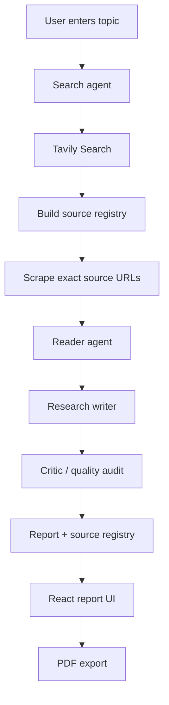

# Multi-Agent AI Research System

A research workspace that turns a topic into a structured, source-traceable report. A LangChain/LangGraph-inspired agent pipeline searches the web, retrieves source pages, analyzes evidence, writes a report, and audits the final result. A React frontend connects to a FastAPI backend for live progress and PDF export.

## Features

- Research a topic from a single prompt.
- Search with Tavily and retain the actual search-tool output as the source registry.
- Retrieve up to three selected source pages using the exact URLs returned by Tavily.
- Analyze retrieved material with a reader agent that has no browsing tools.
- Generate a Markdown report with source-ID citations such as `[S1]`.
- Audit the report for support, source traceability, reasoning, completeness, and unsupported claims.
- Display the multi-step workflow and progress in the browser.
- Export the generated report as a PDF.
- Keep recent research history in the frontend session.

## Architecture



### Agent responsibilities

| Stage | Implementation | Responsibility |
|---|---|---|
| Search | LangChain agent + Cloudflare Workers AI | Formulate and execute web searches through Tavily |
| Evidence retrieval | Python + Requests + BeautifulSoup | Fetch pages at URLs returned by Tavily; record retrieval status |
| Reader | LangChain agent + Groq | Analyze supplied search and scraped content; cannot browse independently |
| Writer | LangChain prompt chain + Groq | Produce a structured report grounded in research context |
| Critic | LangChain prompt chain + Cloudflare Workers AI | Audit evidence support, citations, source integrity, and report quality |

Source URLs are collected from Tavily tool output in Python. The writer is instructed not to invent URLs or build a Sources section; the application appends the source list from the tool records. A source can be listed even when page retrieval is inaccessible, with its retrieval status shown.

## Tech Stack

**Frontend:** React 18, Vite, Tailwind CSS, React Markdown, remark-gfm, canvas-confetti, Vercel Analytics and Speed Insights.

**Backend:** Python, FastAPI, Uvicorn, Pydantic, FPDF2, threading, Server-Sent Events (SSE).

**AI and research:** LangChain, LangChain agents, Groq, Cloudflare Workers AI, Tavily Search.

**Retrieval and parsing:** Requests, BeautifulSoup, lxml.

## Request lifecycle

1. The frontend sends a topic to `POST /api/research`.
2. The API validates the topic, enforces a per-IP active-run guard and a server-wide concurrency cap, then starts a worker thread.
3. The worker runs `run_research_pipeline()` and captures its progress messages.
4. The frontend subscribes to `GET /api/research/{job_id}/events` for Server-Sent Events.
5. When the pipeline completes, the UI displays the report, audit feedback and available source links.
6. The frontend can request a PDF through `POST /api/pdf`.

## API

| Method | Endpoint | Purpose |
|---|---|---|
| GET | `/api/health` | Health check |
| POST | `/api/research` | Start a research job; accepts a topic |
| GET | `/api/research/{job_id}/events` | Subscribe to job events using SSE |
| POST | `/api/pdf` | Generate a PDF from a topic, report and source list |

The research topic is validated to 5–200 characters. The server defaults to two concurrent runs, one active run per client IP, and one-hour retention for completed in-memory jobs. Configure `MAX_CONCURRENT_JOBS` and `CORS_ORIGINS` for your deployment.

## Project structure

```text
Multi_Agent_AI_Research_System/
├── agent.py                  # Search, reader, writer and critic model chains
├── pipeline.py               # End-to-end research orchestration
├── tools.py                  # Tavily search and page scraping tools
├── server.py                 # FastAPI API, jobs and SSE streaming
├── requirements.txt          # Python dependencies
└── frontend/
    ├── package.json
    ├── vite.config.js
    └── src/
        ├── App.jsx
        ├── Stage.jsx
        ├── Report.jsx
        ├── Home.jsx
        ├── useResearch.js
        ├── api.js
        └── index.css
```

## Local setup

Requirements: Python 3.10+ and Node.js (use a version compatible with the Vite project).

### 1. Clone and install backend dependencies

```bash
git clone https://github.com/srini526/Multi_Agent_AI_Research_System.git
cd Multi_Agent_AI_Research_System
python -m venv .venv
```

Activate the environment, then:

```bash
pip install -r requirements.txt
```

### 2. Configure credentials

Create a root `.env` file with the credentials required by the selected model providers and Tavily integration. Common settings used by this repository:

```env
TAVILY_API_KEY=your_tavily_api_key
GROQ_API_KEY=your_groq_api_key
CLOUDFLARE_ACCOUNT_ID=your_cloudflare_account_id
CF_AI_API_TOKEN=your_cloudflare_workers_ai_token
CORS_ORIGINS=http://localhost:5173
MAX_CONCURRENT_JOBS=2
```

Check the model provider integration and account token naming in your deployed environment before running. Never commit real API keys.

### 3. Start the backend

```bash
uvicorn server:app --reload --port 8000
```

### 4. Start the frontend

In another terminal:

```bash
cd frontend
npm install
npm run dev
```

Open `http://localhost:5173`. The Vite development server proxies API requests to the local backend as configured in `vite.config.js`.

### Production build

```bash
cd frontend
npm run build
```

The backend can serve the built `frontend/dist` directory when it exists. Container and deployment scripts in the repository should be reviewed for their target environment before use.

## Limitations

- The report is generated from the available search and scraped evidence; inaccessible pages may leave evidence gaps.
- Only a bounded number of returned sources are scraped in a run.
- Search snippets are not treated as proof that an entire page was read.
- Job state is held in server memory and is not a durable distributed job queue.
- The report critic provides model-generated quality feedback; it is not a formal fact-checking guarantee.
- The pipeline does not guarantee that every topic will have sufficient reliable public sources.

## Future work

See [PLAN.md](./PLAN.md) for the proposed roadmap.

## Security

Keep API keys in environment variables or deployment secrets. Do not commit `.env`. Restrict CORS to the real frontend origin in deployment, protect provider quotas, and avoid exposing an unauthenticated public research endpoint without appropriate traffic controls.

---

Built as a practical exploration of agent orchestration, tool use, evidence-grounded writing, and research quality review.
